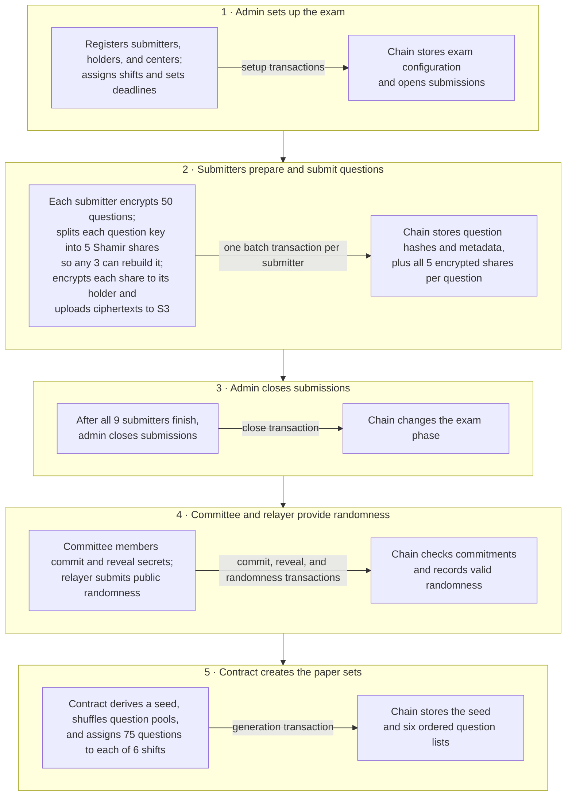
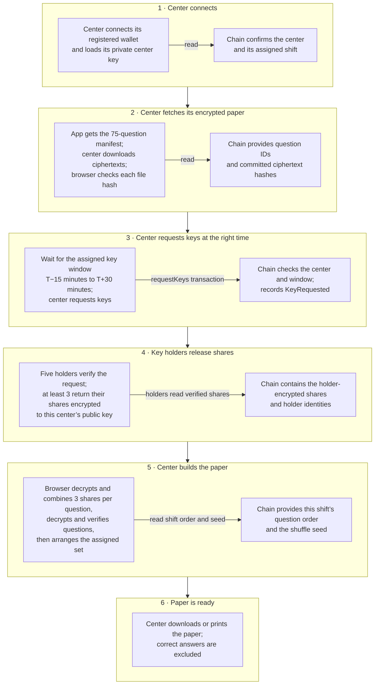

# EPLPS prototype flow

Read each diagram from top to bottom in the **App flow** column. Arrows to the right show what the app commits to or reads from the Cosmos EVM chain. Question files and holder packages travel off chain; question decryption happens in the center’s browser.

## 1. Set up the exam and generate paper sets

## 2. Center fetches its paper

### What stays off chain

- Plaintext questions and encrypted question files are stored off chain; the files live in S3-compatible object storage.
- Holder packages are sent to the center by the key-holder services.
- The center reconstructs question keys and creates the printable paper in its browser.
