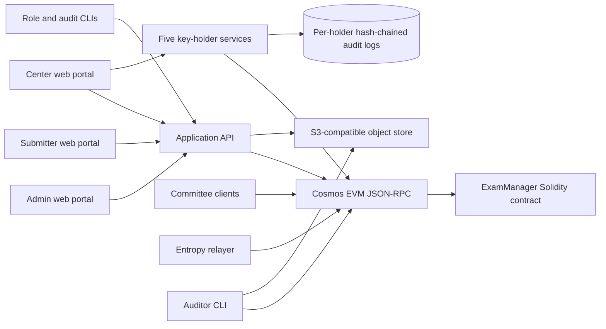

# EPLPS Prototype Architecture

Status: Architecture baseline  
Date: 7 November 2026  
Scope: Full functional prototype based on the EPLPS SRS, deployed to a self-hosted Cosmos EVM chain

## 1. Architecture decisions

1. **Preserve the SRS workflow and fixed parameters.** The prototype has 3 subjects, 3 entities per subject, 9 submitters, 50 questions per submitter, 6 shifts, 75 questions per shift, a 5-member randomness committee with a 3-reveal minimum, timed key requests, per-center ordering, and post-exam audit.
2. **Use Cosmos EVM as the execution environment, not a new application protocol.** Deploy the Solidity contract to the self-hosted EVM-compatible chain and use standard EVM JSON-RPC, Solidity events, and ethers v6. Keep chain settings configurable so local Hardhat and the target Cosmos EVM network can run the same contract and clients.
3. **Build the complete role workflows, with a web interface as the user-facing layer.** Provide submitter, admin, and center web portals over shared application services. The CLI clients remain useful for development, committee operations, relaying, and audit. The center portal supports early ciphertext download and the timed paper/key workflow; it does not expose questions before key release.
4. **Keep question content off-chain and publish only holder-encrypted shares on-chain.** The contract stores commitments, scheduling, role assignments, paper question IDs, individual share hashes, and five sealed share payloads per question. Encrypted question blobs live in RustFS/S3-compatible storage. Each payload is sealed to the corresponding holder's X25519 public key, so chain readers see ciphertext but cannot decrypt a share. There is no exam-wide master key.
5. **Batch each submitter's 50 questions into one contract transaction.** The submitter signs one ordered manifest to authorize the API uploads, uploads the 50 encrypted blobs to S3, then makes one wallet-confirmed `submitQuestions` call carrying all 50 metadata records and their holder-encrypted shares. The contract validates and records the full batch atomically and emits per-question events. No Merkle root is needed while the complete commitments and sealed shares are included on chain. Validate the resulting calldata, gas, and block limits on the target Cosmos EVM chain.
6. **Keep paper randomness and question-key custody distinct.** Committee commit/reveal plus optional ANU entropy derive the paper-selection seed; Fisher–Yates shuffles each entity pool, specified slices distribute questions to shifts, and per-center order is derived off-chain. Separately, each question's AES key is split into five Shamir shares; three shares are required for reconstruction. This intentionally replaces the SRS's sealed-box question-key wrapper with a simpler per-question threshold flow.
7. **Treat the target chain as a production-like integration target, not a trust upgrade.** A self-hosted network can improve operational control, but its validators/operator and RPC infrastructure remain trust assumptions. The architecture does not claim public-chain decentralization or protection from colluding operators.

## 2. System context



The application API is a web-facing orchestration layer. It does not replace contract authorization: contract transactions are signed by the acting role, and the contract remains authoritative for phase, quota, schedule, and center eligibility. The API handles upload coordination, transaction tracking, configuration, and browser-safe workflows. Each key-holder service handles one share index and releases only that holder's share to an authorized center.

## 3. Components and responsibilities

### 3.1 On-chain contract: `ExamManager`

Deploy the contract to Cosmos EVM. It owns role registration, phase transitions, immutable submissions and per-share hash commitments, randomness commitments/reveals, ANU value recording, deterministic paper generation, center registration/revocation, key-request events, rescheduling, and post-exam finalization.

Implementation uses Solidity `^0.8.24`, OpenZeppelin utilities where helpful, custom errors, and ethers v6 clients. The deployment configuration supplies chain ID, RPC URLs, contract address, confirmations/finality policy, and deployment signer. Do not assume a specific Cosmos SDK module or chain-specific precompile; use EVM-compatible behavior only unless target-chain validation proves otherwise.

The contract must not accept arbitrary chain parameters from an untrusted browser. Admin calls are wallet-signed and contract-checked. Each UI transaction is submitted through the user's wallet or a configured role signer, according to the deployment's custody model.

### 3.2 Application API

Use a TypeScript service (Fastify) for web workflows. It provides authenticated application endpoints for:

- setup metadata and read-only phase/status views;
- submitter upload sessions, object-store upload URLs, transaction submission/status, quota and completion summaries;
- admin setup and schedule operations, with wallet-signed contract transactions;
- center enrollment/readiness, ciphertext manifests, request status, and paper artifact retrieval;
- center role views and ciphertext delivery; centers contact the five key holders directly for signed share packages;
- audit/report downloads and operational health.

The API does not hold user seed phrases. Wallet-based roles sign transactions in the browser for admin, submitter, and center operations. A deployment may use a managed signer for the admin only if the operator explicitly accepts that custody model. Server authentication and wallet-address authorization must agree with on-chain roles before disclosing role-specific data.

### 3.3 Web portals

- **Admin portal:** connect admin wallet; register actors and centers; configure schedule and randomness deadlines; inspect readiness and progress; open/close phases; revoke centers; reschedule eligible shifts; finalize the exam after the last shift; download audit results.
- **Submitter portal:** connect registered submitter wallet; validate an exactly-50-question JSON package; encrypt each question, sign one upload authorization for the ordered ciphertext manifest, and upload all ciphertext blobs; then submit all 50 commitments and five indexed holder-encrypted shares per question in one wallet-confirmed batch transaction. Stage artifacts locally to resume interrupted uploads or safely retry a failed transaction; show batch progress and quota status without logging or echoing question text into application telemetry.
- **Center portal:** connect center wallet; download and verify ciphertext early; show its shift and key-window countdown; request keys only in its shift window; verify signed package; decrypt locally in the browser or through a tightly scoped local client; build/download a printable paper and `paper.json`. The UI must never request or display another center's package. The deployed design should prefer browser-side decryption using the center's locally held X25519 key.

The center paper contains questions and options but no answers. It prints shift ID and center identifier on every page as in the SRS. Per-center ordering follows the SRS algorithm. The order is a tracing aid, not proof of leak origin by itself.

### 3.4 Crypto package

Shared TypeScript library owns payload validation, JCS canonicalization, AES-256-GCM question encryption, 3-of-5 Shamir split/reconstruction for question keys, center-share transport encryption, hashing, decryption, deterministic seed calculation, pool shuffle/slicing, per-center ordering, and test vectors. Browser-compatible crypto must be evaluated for the portal; use libsodium's supported browser build or a small shared interface with Node and browser adapters. Keep key material and decrypted payloads out of logs, analytics, and server error reports.

### 3.5 Object storage

Use RustFS for local development and an S3-compatible service in the self-hosted deployment. Store only `<objectId>.ct` question ciphertext blobs in a bucket scoped to chain ID and contract. RustFS is an S3-compatible file/object store; it keeps the larger encrypted question files off-chain. Shamir shares are not stored there. A hash proves integrity, not confidentiality or availability.

### 3.6 Key service

Each key-holder service has a fixed share index (1–5), checks that its signer and X25519 public key match the registered committee member, and decrypts only its indexed `KeySharePublished` event payloads. It verifies the center's signed request, on-chain receipt/event, shift window, registration and revocation, checks each recovered share against its on-chain hash, seals the shares to the center's X25519 key, signs its package, and records the release in its own hash-chained audit log. The center collects any three valid packages and reconstructs AES keys locally. After finalization, each holder can provide its raw indexed shares in a signed audit package.

### 3.7 Committee, entropy relayer, and auditor

Committee members use local clients to commit and reveal secrets and serve as the five key-share holders. The entropy relayer uses a pluggable provider; local development uses deterministic mock entropy for reproducibility and labels the insecure CSPRNG mode clearly. The provider is never queried before the configured reveal deadline. Auditor CLI replays events and independently recomputes seed, pool shuffles, shift slices, hashes, requests, and post-finalization plaintext commitments.

## 4. Data and trust boundaries

| Data | Location before exam | Visibility |
|---|---|---|
| Role, schedule, commitments, hashes, question IDs, randomness events | Cosmos EVM contract | Public to chain participants |
| Encrypted question blobs | RustFS/S3-compatible object storage | Ciphertext; hash checked against chain |
| Shamir share payloads | `KeySharePublished` contract events | Public ciphertext sealed to one holder's X25519 key; plaintext share hash checked against chain |
| Individual question AES keys | Reconstructed from any three valid shares in center memory | Eligible center during its release window |
| Center X25519 private key | Center-controlled wallet/device storage | Center only, subject to local security |
| Decrypted paper and answers | Center device after T−15 | Center personnel; center can copy or disclose it |

The prototype reduces early exposure and makes tampering auditable. It cannot prevent disclosure by three colluding key-share holders or an authorized center after release. The answer is part of each question payload under the SRS, so the center receives answers with the paper; answer separation remains a stretch goal.

## 5. Cosmos EVM deployment architecture

Use the same contract artifact for local Hardhat and target Cosmos EVM. Maintain separate environment profiles for local, staging, and demonstration/production-like deployment. Required target-chain inputs are:

- chain ID and RPC endpoint(s), plus WebSocket endpoint if event subscription is enabled;
- block time/finality behavior and confirmation policy;
- native gas token denomination and funding process for role accounts;
- EVM compatibility/version and supported transaction types;
- validator/operator availability and chain reset/upgrade process;
- object store, API, key-service, TLS, and backup endpoints.

All event consumers must support reconnect and replay from a persisted block cursor; correctness must not depend on a live WebSocket subscription. Use receipts and canonical block timestamps for window checks. For reorg handling, wait for the configured confirmation/finality threshold before treating a transaction as settled, and make client operations resumable/idempotent. Because this is a self-hosted chain, document who controls validators, RPC nodes, upgrades, and backups in the deployment runbook.

Keep `chainId`, contract address, RPC URLs, object-store endpoint, and API URLs in validated environment/config files. Never hard-code target chain addresses or assume Cosmos-specific JSON-RPC extensions. A local Hardhat network remains the fast development environment; a target-chain smoke deployment is required before claiming Cosmos EVM compatibility.

## 6. Main workflows

### 6.1 Setup and question submission

Admin deploys/configures contract, registers nine submitters and five committee members (who also hold the corresponding key shares), registers each holder's X25519 public key in committee order, sets the relayer, registers six shifts and centers, sets randomness deadlines, then opens submissions. A submitter portal validates 50 payloads, encrypts each independently, splits each AES key into five shares, uploads the 50 ciphertext blobs to RustFS, seals each share to its holder's public key, and submits the 50 ciphertext commitments, share hashes, and sealed shares in one `submitQuestions` transaction. The batch is atomic: it is fully recorded or fully reverted. Artifacts remain staged locally so the portal can resume uploads or retry a failed batch. Admin closes only after each submitter reaches quota.

### 6.2 Randomness and paper generation

Committee commit and reveal windows and optional entropy window follow the contract. The contract derives the seed from ANU value (or zero after a missed window) and revealed committee values in registration order, enforces at least three reveals, shuffles each ascending entity pool using the specified hash-based Fisher–Yates algorithm, and slices exact 9/8/8 allocations across six shifts. The output is six on-chain ordered 75-ID lists. Shared cross-language vectors lock Solidity and TypeScript behavior.

### 6.3 Center fetch, timed release, and printing

Centers can download ciphertext before the exam and verify hashes without keys. At T−15 through T+30 for its assigned shift, the center submits `requestKeys`, signs the request, and contacts the five share-holder services. It accepts any three valid, holder-signed packages, reconstructs keys locally, verifies plaintext commitments and schema, applies its deterministic center order within each subject, then creates printable paper/PDF and `paper.json`. All output includes center/shift identifiers and excludes answers from the paper rendering.

### 6.4 Closure and audit

After the last shift end, admin finalizes the exam. Auditor verifies event history, counts, uniqueness/disjointness, randomness, slices, ciphertext and share hashes, and key requests. It requests signed post-exam share packages from the holders, checks each share against its on-chain commitment, reconstructs question keys from any three holders, and checks plaintext commitments and payload schemas. The report is available as JSON and human-readable output.

## 7. Repository shape

```text
apps/
  api/                 Fastify orchestration API
  admin-web/           Admin portal
  submitter-web/       Submitter portal
  center-web/          Center portal
  key-service/         Share-holder service; run one process per share index
  admin-cli/ submitter-cli/ committee-cli/ center-cli/ auditor-cli/
packages/
  contracts/           ExamManager, deployment scripts, contract tests
  crypto/              Shared crypto, validation, seed/shuffle/slicing vectors
  shared/              EVM client, config, logging, API types
  ui/                  Shared web components and wallet integration
scripts/
  demo.ts              Reproducible end-to-end local demo
infra/
  docker-compose.yml   Local object store; other services run from npm workspaces
  cosmos-evm/          Target-chain deployment/runbook templates
docs/
  ARCHITECTURE.md
  DECISIONS.md
  DEPLOYMENT.md
```

Use npm workspaces, Node 20+, TypeScript strict mode, Solidity `^0.8.24`, Hardhat, ethers v6, Fastify, zod, canonicalize (RFC 8785), libsodium-wrappers, and a web stack that supports wallet connection and browser-side crypto. Keep the UI framework replaceable; it must consume shared typed APIs rather than duplicate business or cryptographic logic.

## 8. Prototype completion boundary

The prototype retains the SRS submission, randomness, distribution, and center-release workflows, but intentionally replaces its sealed-box key wrapper with per-question 3-of-5 Shamir shares sealed individually to five registered X25519 holder keys. It removes the exam-wide master key. RustFS holds only encrypted question files; encrypted shares are emitted by the contract. Each submitter commits all 50 questions in one batch transaction; this prototype does not use a Merkle-root-only batch commitment. Other simplifications are operational: one self-hosted EVM chain, mock entropy for deterministic demos, and a single API deployment. The admin, submitter, and center user-facing portals are additional required product surfaces. Public-chain anchoring, Besu network, and separately sealed answers remain outside the current prototype scope.

Acceptance still includes 450 submissions, all six generated shifts, center-specific timed share release, printing without answers, chain/storage tamper detection, post-exam key reconstruction from shares, and a complete auditor pass. A reduced integration demo may use generated fixtures, but it must exercise the same algorithms and contract rules as the full parameter set.

## 9. Open implementation decisions to record before coding

- Target Cosmos EVM distribution/version, chain ID, finality/confirmation policy, and gas token.
- Wallet library and supported wallet custody model for each portal.
- Browser crypto adapter and private-key persistence mechanism for center keys.
- Authentication/session approach for API features that are not on-chain.
- PDF renderer and whether it runs in browser or center-side local tooling.
- API/object-store/key-service deployment topology, TLS, backups, and audit-log retention.
- Shift overlap policy, precise schedule validation, and revocation semantics for historical requests.

Resolve these in `docs/DECISIONS.md`; they must not change the SRS cryptographic and distribution rules without an explicit recorded decision.
